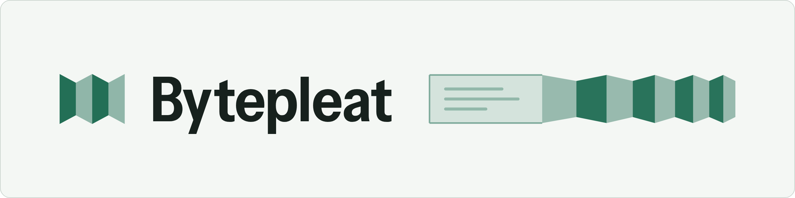
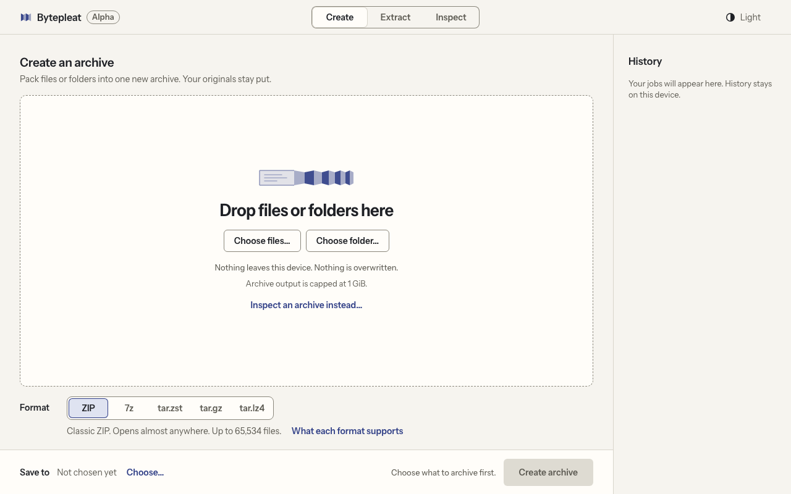
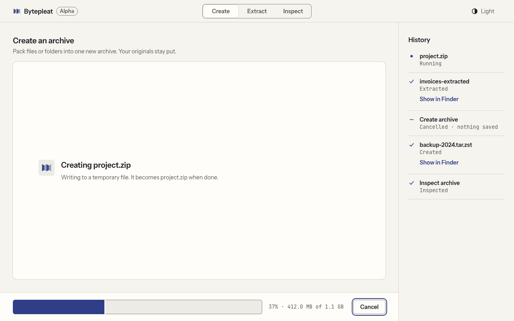
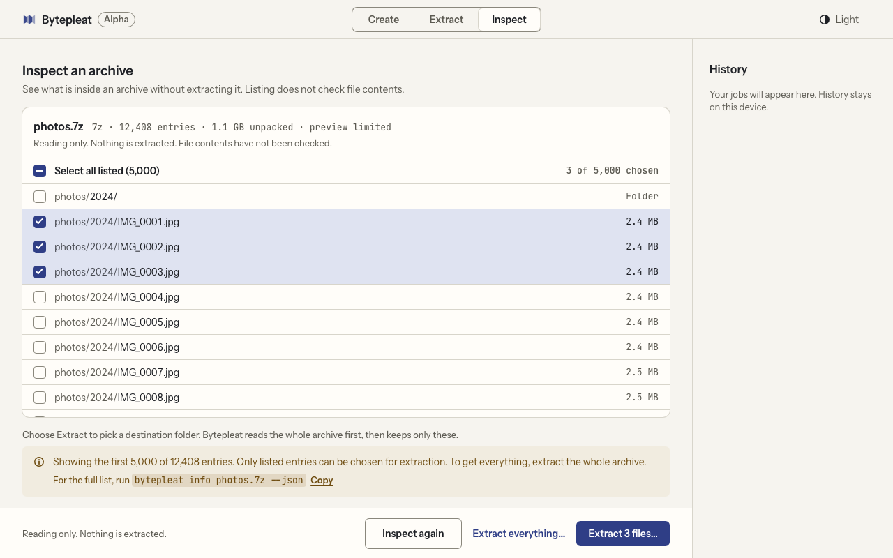

<p align="center">
  <picture>
    <source media="(prefers-color-scheme: dark)" srcset="docs/images/banner-dark.png">
    <source media="(prefers-color-scheme: light)" srcset="docs/images/banner-light.png">
    
  </picture>
</p>

<p align="center">
  Compress files, pack folders, and restore the same bytes, using standard formats.
</p>

<p align="center">
  <a href="https://github.com/megasoft1978/bytepleat/actions/workflows/ci.yml"></a>
  <a href="https://github.com/megasoft1978/bytepleat/releases"></a>
  <a href="LICENSE"></a>
  <a href="#desktop-app-alpha"></a>
</p>

<p align="center">
  <a href="#install">Install</a> ·
  <a href="#quick-start">Quick start</a> ·
  <a href="#supported-formats">Formats</a> ·
  <a href="#desktop-app-alpha">Desktop app (alpha)</a> ·
  <a href="https://megasoft1978.github.io/bytepleat/">Website</a>
</p>

> [!NOTE]
> The command-line tool is released (version 0.5.1). The desktop app is an early alpha without an installer, and release packages are unsigned.

<p align="center">
  <picture>
    <source media="(prefers-color-scheme: dark)" srcset="docs/images/app-empty-dark.png">
    <source media="(prefers-color-scheme: light)" srcset="docs/images/app-empty-light.png">
    
  </picture>
</p>

## Why Bytepleat

- Uses established formats (Zstandard, gzip, LZ4, ZIP, 7z, tar). It does not add a proprietary archive format.
- Runs on your device. Your input files are never moved or removed.
- Careful file handling: output is written to a temporary file first, nothing is overwritten by default, and extraction goes into a new folder.
- One command-line tool for single files and folder archives, with a `test` command that fully decodes an archive before you extract it.

## When to use something else

Bytepleat is small and strict on purpose. Mature tools do more.

- **You need RAR, encrypted or password-protected archives, ZIP64, split archives, or arbitrary 7z files.** Bytepleat does not handle these (see [supported formats](docs/formats.md)). Use a tool that does, such as 7-Zip, Keka or The Unarchiver, and check its documentation for its current format list.
- **You need a full filesystem backup.** Permissions, ownership, links, extended attributes, and timestamps are not restored. Use a backup tool, or `tar` with the options your system documents.
- **You already use 7-Zip, `tar` with `zstd`, or your system's archive tool, and it does what you need.** Those are mature, widely available tools. Bytepleat is a smaller, stricter alternative, not a replacement.

## Install

Release 0.5.1 command-line packages are on the [releases page](https://github.com/megasoft1978/bytepleat/releases/tag/v0.5.1). Download the archive for your platform and its matching `.sha256` file, check it, then extract it. Packages are unsigned and the macOS build is not notarized. More detail is in [RELEASE.md](RELEASE.md).

| Platform | Package | SHA-256 |
| --- | --- | --- |
| macOS, Apple silicon | [`bytepleat-0.5.1-aarch64-apple-darwin.tar.gz`](https://github.com/megasoft1978/bytepleat/releases/download/v0.5.1/bytepleat-0.5.1-aarch64-apple-darwin.tar.gz) | `6db85206c31c15ae4f57ec855544c0f7ec47a0950f7d74f3b424964a69118cfc` |
| Linux, x86-64 | [`bytepleat-0.5.1-x86_64-unknown-linux-gnu.tar.gz`](https://github.com/megasoft1978/bytepleat/releases/download/v0.5.1/bytepleat-0.5.1-x86_64-unknown-linux-gnu.tar.gz) | `affec47bd8c77a817441f4d65095c741fdeafc66a73fc322c8e675876abc062b` |
| Windows, x86-64 | [`bytepleat-0.5.1-x86_64-pc-windows-msvc.zip`](https://github.com/megasoft1978/bytepleat/releases/download/v0.5.1/bytepleat-0.5.1-x86_64-pc-windows-msvc.zip) | `a042877cad44a8e0fe406a0a11c0a06e105e91287469a67275ba50d2ecff26f4` |

A checksum detects a damaged download. It is not a signature and does not show who built the file.

**macOS (Apple silicon)**

```sh
curl -LO https://github.com/megasoft1978/bytepleat/releases/download/v0.5.1/bytepleat-0.5.1-aarch64-apple-darwin.tar.gz
curl -LO https://github.com/megasoft1978/bytepleat/releases/download/v0.5.1/bytepleat-0.5.1-aarch64-apple-darwin.tar.gz.sha256
shasum -a 256 -c bytepleat-0.5.1-aarch64-apple-darwin.tar.gz.sha256
tar -xzf bytepleat-0.5.1-aarch64-apple-darwin.tar.gz
./bytepleat-0.5.1-aarch64-apple-darwin/bytepleat --help
```

**Linux (x86-64)**

```sh
curl -LO https://github.com/megasoft1978/bytepleat/releases/download/v0.5.1/bytepleat-0.5.1-x86_64-unknown-linux-gnu.tar.gz
curl -LO https://github.com/megasoft1978/bytepleat/releases/download/v0.5.1/bytepleat-0.5.1-x86_64-unknown-linux-gnu.tar.gz.sha256
sha256sum -c bytepleat-0.5.1-x86_64-unknown-linux-gnu.tar.gz.sha256
tar -xzf bytepleat-0.5.1-x86_64-unknown-linux-gnu.tar.gz
./bytepleat-0.5.1-x86_64-unknown-linux-gnu/bytepleat --help
```

There is no Linux ARM64 package. Older Linux systems may need a source build.

**Windows (x86-64, PowerShell)**

Needs the x64 [Microsoft Visual C++ v14 runtime](https://learn.microsoft.com/en-us/cpp/windows/latest-supported-vc-redist), which is not bundled.

```powershell
$asset = 'bytepleat-0.5.1-x86_64-pc-windows-msvc.zip'
$base = 'https://github.com/megasoft1978/bytepleat/releases/download/v0.5.1'
Invoke-WebRequest -Uri "$base/$asset" -OutFile $asset
Invoke-WebRequest -Uri "$base/$asset.sha256" -OutFile "$asset.sha256"
$entry = Get-Content -LiteralPath "$asset.sha256" -Raw
if ($entry -notmatch '^([0-9a-fA-F]{64})\s+bytepleat-0\.5\.1-x86_64-pc-windows-msvc\.zip\s*$') { throw 'Invalid checksum sidecar or filename' }
if ((Get-FileHash -LiteralPath $asset -Algorithm SHA256).Hash -ne $Matches[1]) { throw 'SHA-256 mismatch' }
Expand-Archive -LiteralPath $asset -DestinationPath .
.\bytepleat-0.5.1-x86_64-pc-windows-msvc\bytepleat.exe --help
```

To run `bytepleat` from anywhere, add the extracted folder to your `PATH`.

**From source with Cargo** (Rust 1.93 or newer and a C compiler toolchain)

```sh
cargo install --locked --git https://github.com/megasoft1978/bytepleat --tag v0.5.1
```

## Quick start

```sh
# Compress one file, then restore it
bytepleat compress report.pdf
bytepleat decompress report.pdf.zst -o report-restored.pdf

# Pack a folder into an archive, then extract it into a new folder
bytepleat pack project -o project.tar.zst
bytepleat unpack project.tar.zst -o project-restored

# Look inside without extracting, then fully decode and check
bytepleat info project.tar.zst --json
bytepleat test project.tar.zst
```

Zstandard is the default. Without `--format`, the archive type follows the `-o` extension (`.zip`, `.7z`, `.tar.zst`/`.tzst`, `.tar.gz`/`.tgz`, `.tar.lz4`). A `--format` that conflicts with the extension is an error. Use `--format` for another codec or archive type, for example `bytepleat pack project --format zip -o project.zip`. The [user guide](docs/user-guide.md) covers presets, pipes, and archive options.

## Supported formats

| Format | Create | Open and test | Limits |
| --- | --- | --- | --- |
| Zstandard, gzip (single file) | Yes | Yes | Only Zstandard uses multiple threads |
| LZ4 (single file) | Yes | Yes | Concatenated LZ4 frames are rejected |
| tar + Zstandard, gzip, or LZ4 (folder) | Yes | Yes | `pack` needs a directory; regular files and directories only |
| ZIP | Yes | Yes | Classic Stored/Deflate only; no ZIP64, encryption, or split volumes; up to 65,534 entries |
| 7z | Yes | Yes | Writer uses LZMA2; reader handles a bounded subset, unencrypted and single-volume; up to 100,000 entries |
| Pco (numeric data) | Yes | Yes | Raw little-endian numbers with an explicit `--type`; not for general files or CSV |
| RAR | No | No | Recognized by `info` only |

Not supported: passwords and encryption, ZIP64, split archives, RAR extraction. Exact boundaries are in [docs/formats.md](docs/formats.md).

## Safety behavior

- **Your inputs stay put.** Input files are never modified, moved, or removed.
- **No silent overwrites.** Named outputs are written to a temporary file and only get their final name after success. If the output already exists, the command stops with an error unless you pass `--force`.
- **Extraction goes into a new folder.** The destination must not exist yet. The archive is checked in a staging folder first, and only regular files and directories are accepted. Links, special files, and unsafe paths are rejected. Moving many extracted files into place is best-effort, not atomic.
- **Size caps by default.** 1 GiB of decoded output, 1 GiB of compressed ZIP input, 100,000 archive entries, path depth 64, and a 128 MiB Zstandard window. Some can be changed with options such as `--max-output`.
- **Streams are not all-or-nothing.** Output to stdout can be partial if an error occurs. Use a named output when you need a complete result or nothing.
- **Checks are about integrity, not trust.** `test` checks decoding and format integrity. Neither `test` nor `info` checks who sent a file or scans for malware.

See [security and limits](docs/security-limits.md).

## Desktop app (alpha)

A desktop window for creating, extracting, and inspecting ZIP, 7z, and compressed tar archives. It never replaces existing files, and cancelling removes its temporary output.

<p align="center">
  
  
</p>

The screenshots show the interface with sample data.

It is an early alpha with no installer, and platform testing is incomplete. See [docs/desktop-validation.md](docs/desktop-validation.md) for what has and has not been checked. To run it from source you need Rust 1.93 or newer, Node.js/npm, and the [Tauri v2 prerequisites](https://v2.tauri.app/start/prerequisites/):

```sh
cd desktop
npm install --ignore-scripts
npm run tauri -- dev
```

The contributor guide is in [desktop/README.md](desktop/README.md).

## Build and contribute

```sh
git clone https://github.com/megasoft1978/bytepleat.git
cd bytepleat
cargo build --release --locked
```

The binary is `target/release/bytepleat` (`.exe` on Windows). Before opening a pull request, run the checks in [CONTRIBUTING.md](CONTRIBUTING.md).

More: [changelog](CHANGELOG.md) · [security reporting](SECURITY.md) · [support](SUPPORT.md) · [release notes](RELEASE.md) · [benchmarks and method](docs/benchmarks.md) · [project website](https://megasoft1978.github.io/bytepleat/)

## License

Bytepleat is [MIT licensed](LICENSE). Dependencies keep their own licenses; see [THIRD-PARTY.json](THIRD-PARTY.json) and the [vendored dependency notes](vendor/README.md).
